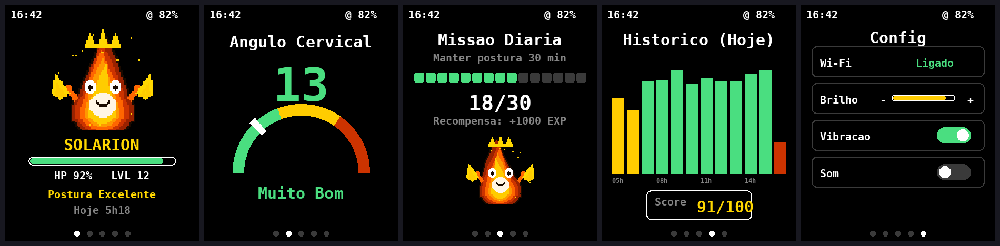
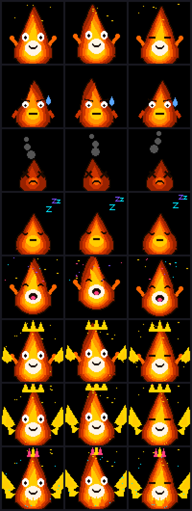

# 🔥 Ergo'Gotchi

**A chama vive da tua postura. Alimenta-a com ergonomia.**
*Your posture is alive.*

Ecossistema de monitorização ergonómica com gamificação estilo Tamagotchi:
uma **web app / PWA** (desktop e mobile) usa a câmara com MediaPipe para analisar
a postura em tempo real — 100% no browser, sem servidor — e um **colar wearable**
opcional (ESP32-C6 + AMOLED 1.8") mede o ângulo cervical com IMU.

## 📱 App

**➜ Abrir: https://fragoso.cloud/gotchi/**

- **Visão computacional local** (MediaPipe Pose) — o vídeo nunca sai do dispositivo
- **Ângulo cervical** combinado: cabeça-à-frente, flexão (orelha→nariz) e queda da
  cabeça (queixo ao peito), com **calibração** da tua postura correta
- **Verificações extra**: cabeça apoiada na mão, cabeça inclinada de lado,
  ombros encolhidos, pulsos acima dos cotovelos, tronco inclinado
- **Jogo**: HP, EXP, missão diária (30 min), conquistas e evolução
  EMBER → SOLARION (30 d) → GUARDIAN (90 d) → PHOENIX (180 d)
- **👻 Morte e ressurreição**: 10 min com HP 0 em má postura → a chama morre e
  vira fantasma (streak a 0, EXP a metade). 30 min de boa postura → renasce com 50 HP
- **Coach IA** no dispositivo (WebLLM, Llama 3.2 1B — precisa de WebGPU, ~800 MB
  descarregados uma vez), horas de risco aprendidas e exercícios sugeridos
- **Alertas** sonoros escalonados, voz (TTS) e vibração (telemóvel)
- **Voz em português de Portugal**: escolhe automaticamente uma voz pt-PT (a "Raquel"
  natural no Edge, Joana/Catarina no iPhone/Mac); só usa pt-BR se não houver nenhuma
- **🎭 Personalidade do Gotchi** (Config): 🔥 Amigável · 🪖 Sargento · 😏 Sarcástico ·
  🤡 Piadolas · 🧘 Zen — cada uma muda as frases (PT/EN), o tom e a velocidade da voz
  e o estilo do Coach IA
- **PT / EN** em toda a app (incluindo as falas da chama)
- **⌚ Ligação ao colar por Bluetooth**: botão "COLAR" no topo (Chrome/Edge no PC ou Android).
  Ligados, há um só Gotchi: a câmara envia o ângulo ao colar e a app mostra o estado dele
- **PWA instalável**: botão "Instalar" no Chrome/Edge; no iPhone, Partilhar →
  "Adicionar ao ecrã principal". Funciona offline depois da primeira visita

| Feliz | Evoluído | 👻 Fantasma |
|:---:|:---:|:---:|
|  |  |  |

> A instalação PWA e a câmara no telemóvel exigem HTTPS — por isso a app corre
> no GitHub Pages e não a partir do ficheiro aberto localmente.

## ⌚ Firmware do colar (v5)

Pasta [`firmware/ErgoGotchi/`](firmware/ErgoGotchi/) — Arduino para
**Waveshare ESP32-C6-Touch-AMOLED-1.8**: 5 ecrãs com swipe, 9 estados de sprite
(incluindo o fantasma), sons pelo altifalante ES8311, calibração por vetor de
gravidade, idioma PT/EN, as mesmas regras de morte/ressurreição da app e
**Bluetooth** para ligar à app.
Instruções no [README do firmware](firmware/ErgoGotchi/README.md).

## 🎬 Vídeos promocionais

- [`ergogotchi_promo_vertical_V2.mp4`](ergogotchi_promo_vertical_V2.mp4) — PT, 9:16
- [`ergogotchi_promo_vertical_EN_v2.mp4`](ergogotchi_promo_vertical_EN_v2.mp4) — EN, 9:16
- Vídeo real: ver [`link_video_real.txt`](link_video_real.txt)

## Estrutura

| Caminho | Conteúdo |
|---|---|
| `index.html` | A app inteira (HTML + CSS + JS num só ficheiro) |
| `sw.js` · `manifest.webmanifest` · `icons/` | Suporte PWA (cache offline, instalação) |
| `firmware/ErgoGotchi/` | Sketch Arduino do colar |
| `assets/` | Imagens e GIFs dos sprites |

## Privacidade

Tudo corre localmente: pose, jogo (`localStorage`) e IA (WebLLM). Não há
servidor nem conta. Os únicos downloads são as bibliotecas e modelos
(MediaPipe, WebLLM) a partir de CDNs públicas.
